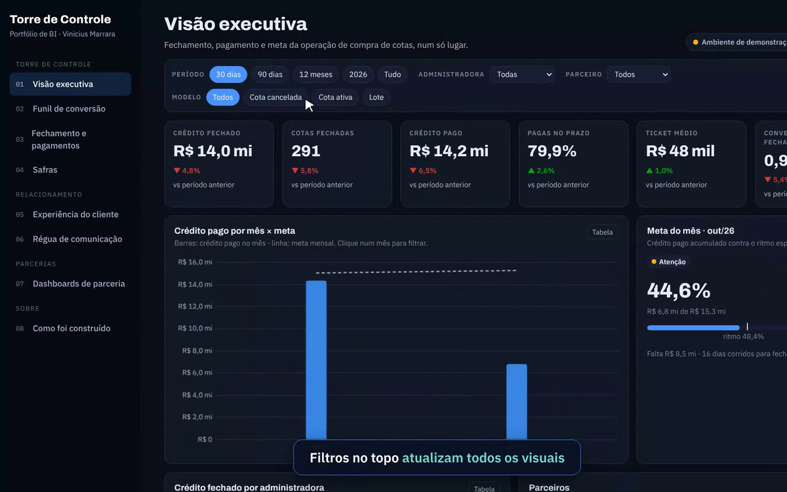

# Torre de Controle · Portfólio de BI

Portfólio navegável, com dados simulados, dos painéis que construo para a operação de uma plataforma de compra de cotas de consórcio: visão executiva, funil, fechamento e pagamentos, safras, experiência do cliente, régua de comunicação e dashboards de parceria.

**[Abrir o painel →](https://vinimarrara.github.io/portfolio-bi/)** · versão completa com 22 painéis: **[Central de Performance →](https://vinimarrara.github.io/central-de-performance/)**

Todos os números e nomes são fictícios.

---
Parte do portfólio de [Vinicius Marrara](https://vinimarrara.github.io/) · [LinkedIn](https://www.linkedin.com/in/vinicius-marrara-dos-santos-423b6973)
